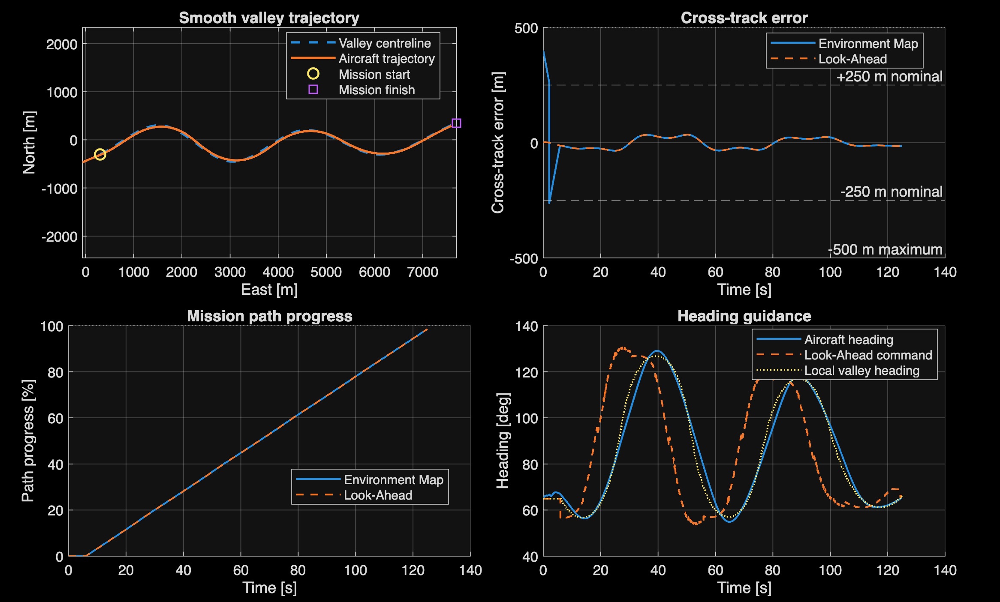
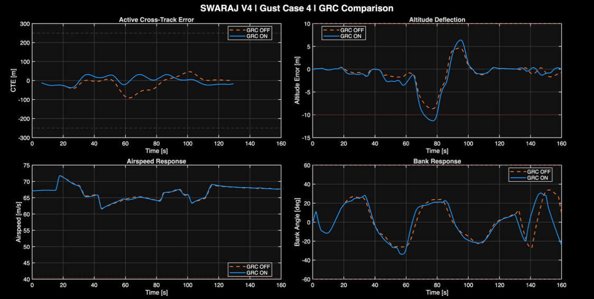

# SWARAJ
### Autonomous guidance, behavioural supervision and aircraft control

**System for Warfare Autonomous Reconnaissance and Adaptive Judgement**  
An independent aerospace research project by **Ninad Samrat Bhave**.

[Read the PDR](../assets/swaraj/SWARAJ_PDR.pdf) · [Project page](https://twistc900.github.io/engineering-portfolio/swaraj.html) · [Results and assessment](docs/RESULTS.md) · [Known issues](docs/KNOWN_ISSUES.md)



## Research question

How can mapped route geometry, aircraft state and disturbance information be coordinated to guide a fixed-wing aircraft through successive bends without continuous pilot steering?

SWARAJ investigates this question through a modular MATLAB/Simulink architecture. The PDR develops the earlier simplified 3-DoF concept into an integrated nonlinear 6-DoF Cessna 182 simulation. The demonstrated scope is guidance and flight control; the broader reconnaissance concept remains future development.

## Control architecture

The Environment Map supplies a fixed mathematical route. Look-Ahead guidance and behavioural supervision interpret approaching curvature and present tracking conditions. Banked Dynamics coordinates manoeuvre requirements, while lateral and longitudinal controllers translate demands into aileron, rudder, elevator and throttle commands. An Energy/Throttle Supervisor coordinates propulsion and longitudinal demands. The supplementary Gust Response Compensator (GRC) adds bounded recovery corrections.

| Function | Responsibility |
|---|---|
| Environment Map | Route geometry, progress and tracking references |
| Look-Ahead and supervision | Manoeuvre preparation, heading selection and recovery priorities |
| Banked Dynamics | Turn-response coordination and vertical-support considerations |
| Lateral controller | Bank, roll/yaw response, aileron and rudder commands |
| Longitudinal controller | Altitude, flight-path and pitch response; elevator commands |
| Energy/Throttle Supervisor | Speed-reference and propulsion coordination |
| GRC | Supplementary disturbance assessment and bounded corrections |

These modules are described in the report; the diagram does not imply independent experimental validation of every module.

## Reported nominal performance

Results below describe the final **125-second, undisturbed** PDR simulation with the revised Energy/Throttle Controller and modular GRC disabled. They are distinct from the earlier tuning sweep.

| Quantity | Recorded result | Project design criterion |
|---|---:|---|
| Peak active-route cross-track error | **34.802 m** | ≤50 m preferred; ≤55 m maximum |
| RMS active-route cross-track error | 22.537 m | Supporting measure |
| Peak absolute altitude error | **1.000 m** | ≤5 m |
| RMS altitude error | 0.531 m | Supporting measure |
| True airspeed | 66.888–67.313 m/s | Minimum ≥58 m/s |
| Maximum absolute aircraft bank | 27.347° | ≤30° nominal target |
| Route completion | Flag asserted; map progress 98.51% | Endpoint definitions need reconciliation |

The criteria are project requirements. Handbook comparisons provide operating context, rather than certification or proof of structural compliance.

## Gust recovery: benefits and trade-offs

Four prescribed wind schedules were compared with GRC disabled and enabled. Peak cross-track error improved most under lateral and combined disturbances. Vertical response worsened in two cases, exceeding the project gust-altitude criterion.

| Wind case | Peak CTE OFF → ON (m) | Peak CTE reduction | Peak absolute altitude error OFF → ON (m) |
|---|---:|---:|---:|
| Longitudinal | 42.307 → 37.820 | 10.61% | 2.140 → 1.744 |
| Lateral | 83.104 → 44.979 | 45.88% | 1.866 → 3.354 |
| Vertical | 34.802 → 34.802 | 0.00% | 7.897 → 10.502 |
| Combined | 91.526 → 37.820 | 58.68% | 8.672 → 11.333 |



These are trajectory-recovery results. They do not establish structural gust-load alleviation. Altitude recovery does not remove a peak-error exceedance.

## Tuning and validation

The report records 44 group-sensitivity cases. Groups were varied separately, with their parameters scaled together. The selected Master Look-Ahead −10% setting reduced peak CTE from 37.005 m to 35.309 m (4.58%), while RMS CTE increased from 21.083 m to 22.561 m. This was a peak-error selection trade-off, not a global optimum.

Further assessment covered nominal flight, independent and combined altitude/speed command changes, and four GRC OFF/ON disturbance cases. The report documents aircraft trim and dynamic-response checks. Raw time histories and a reproducible model release are not included in this showcase.

## Current limitations and next steps

- Improve temporary speed-reference tracking and lateral throttle coordination.
- Refine vertical recovery: GRC-enabled vertical and combined cases exceed the ±10 m gust-altitude criterion.
- Add aircraft-specific speed/load-factor supervision and evaluate transient loads.
- Reconcile route completion/progress and implement terminal guidance.
- Generalise route geometries, geographic mapping and aircraft parameterisation.
- Progress to sensor integration and hardware-in-the-loop evaluation.

## Repository contents

```text
README.md                 Project overview and reported results
assets/                   Figures extracted from the PDR / supporting plots
../assets/swaraj/SWARAJ_PDR.pdf        Supplied personal PDR, unchanged
docs/RESULTS.md            Assessment windows and result provenance
docs/KNOWN_ISSUES.md       Report errata and scope limitations
CITATION.cff              Suggested project citation
```

## Access and reproduction

This is a **documentation and results release**, not an executable autopilot release. It does not include `.slx` models, MATLAB source, an initialisation script or raw simulation logs. Results have been transcribed from the supplied PDR; the simulations were not rerun to create this repository. An independently reproducible code release would need those materials, software versions, dependencies and complete configuration records.

The supplied report is retained unchanged. See [known issues](docs/KNOWN_ISSUES.md) for notation corrections and assessment qualifications. The earlier concept is preserved on the [CDR portfolio page](https://twistc900.github.io/engineering-portfolio/uav.html).

## Attribution and use

Project author: **Ninad Samrat Bhave**. The report acknowledges foundational control literature, aircraft operating references and AI assistance in presentation and document refinement. See its reference list for source attribution. No open-source licence is granted by this documentation release; contact the author for reuse beyond applicable law. Third-party references retain their respective rights.
